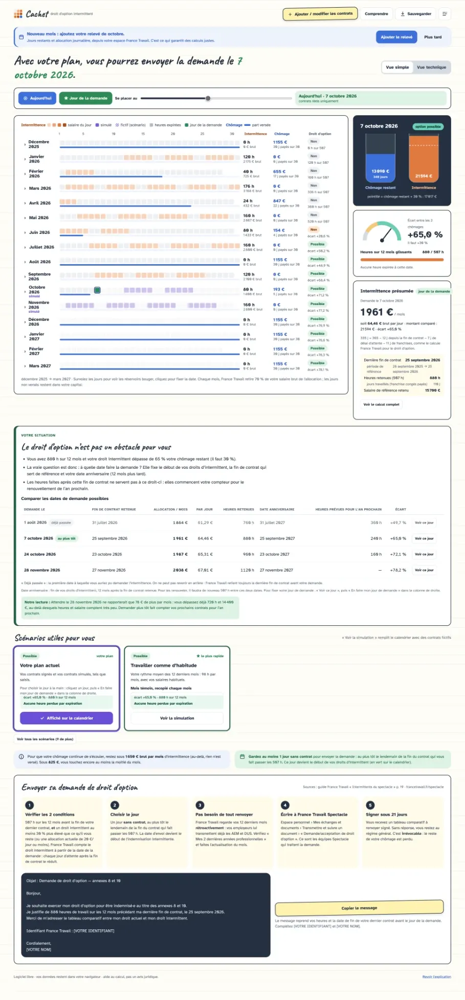
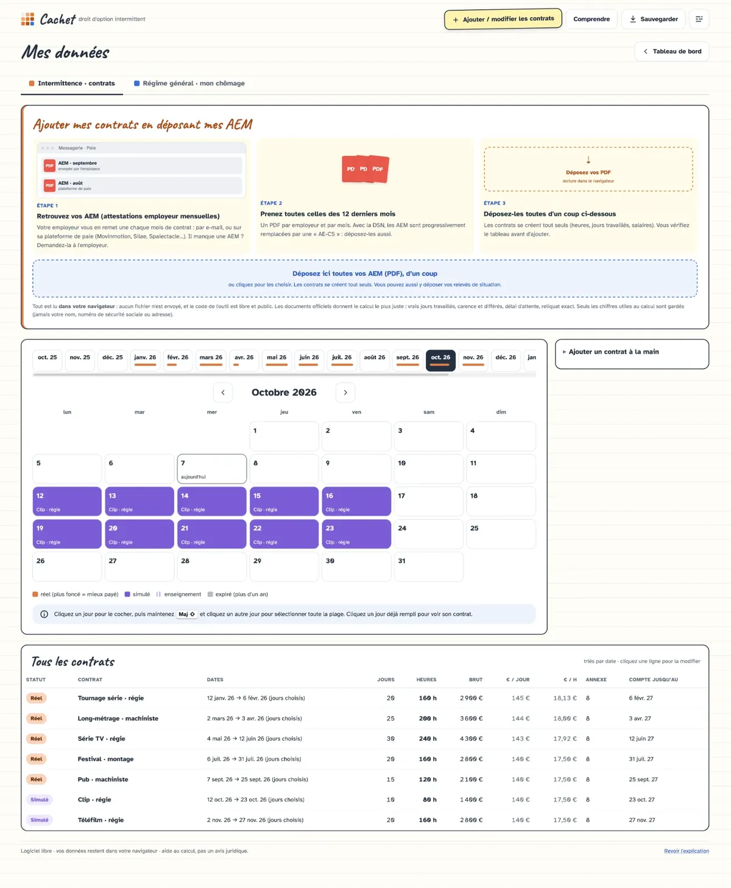
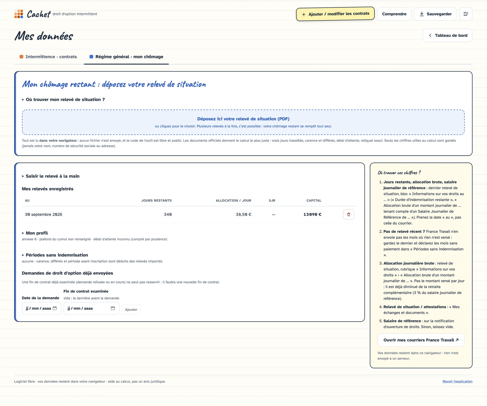

# Cachet · calculateur du droit d'option intermittent

**En ligne : https://cachet.phileas.tv**



Vous êtes au chômage au régime général et vous enchaînez des contrats d'intermittent du spectacle ?
Pour passer intermittent·e, il faut demander le **droit d'option** à France Travail, et il n'est accordé
que sous conditions (507 h sur 12 mois, et un droit intermittent au moins 30 % plus élevé que le chômage
qui vous reste). Cachet calcule **si** et **quand** vous pouvez le demander, mois par mois, et compare
plusieurs stratégies (arrêter de travailler, sprint, un mois sur deux, cours, formation, ARCE…).

> **Outil expérimental.** Testé avec **3 situations et documents réels** (une demande refusée, une demande
> acceptée, une demande en cours), et conçu pour être aussi fiable que possible, il peut pourtant se tromper.
> Ses résultats sont une aide au calcul, pas un avis juridique : seul France Travail décide de vos droits.
>
> **Aidez-moi à le fiabiliser pour le plus grand nombre** : si vous êtes concerné·e, contactez-moi (adresse
> affichée en haut du site) pour tester l'outil avec vos documents.

## Ce que fait l'outil

- **Import de vos documents** (glisser-déposer de PDF) : relevés de situation France Travail et AEM
  (attestations employeur mensuelles, gabarits Unédic standard et XOTIS). Le reliquat, l'allocation,
  le salaire journalier de référence, les carences et différés, les contrats (heures, jours travaillés,
  salaires) se remplissent tout seuls, avec un tableau de vérification avant d'ajouter.
- **Verdict du droit d'option** avec la formule de France Travail, jour par jour, et date de demande conseillée.
- **Simulation des contrats à venir** (comme un mois passé, à peu près mois par mois, ou un par un)
  et scénarios comparés.
- **Détail de chaque calcul** (allocation A + B + C, jours retirés du droit intermittent, règle des 70 %).

## Captures d'écran

Données d'exemple, fictives.

| Contrats : import des AEM, calendrier, liste | Chômage : import du relevé de situation |
|---|---|
|  |  |

## Vie privée

- **100 % dans le navigateur** : site statique, aucun serveur applicatif, aucune base de données,
  aucune requête vers un service tiers (les polices sont servies par le site). Les PDF déposés sont
  lus localement avec pdf.js et jamais envoyés.
- Seuls les chiffres utiles au calcul sont conservés : jamais le nom, l'adresse, le numéro de sécurité
  sociale, l'IBAN ni les coordonnées lues dans les documents.
- **Sauvegarde** : automatique dans le navigateur (localStorage) + export/import d'un fichier `.json`
  (non chiffré : à garder dans un endroit sûr, il contient vos chiffres de chômage et de contrats).
- **Logiciel libre** (AGPL-3.0-or-later) : tout le monde peut lire, vérifier et corriger les calculs.

## Démarrer

> **Note sur le développement.** Le code de Cachet a été écrit en grande partie avec l'aide d'une IA
> (« vibe coding »). Les calculs, eux, ont été vérifiés avec soin sur de véritables dossiers France Travail
> (relevés de situation, AEM, notifications et décisions réelles), et les règles sont sourcées dans le
> tableau plus bas. Relectures et corrections bienvenues.

```bash
npm install
npm run dev      # http://localhost:5180
npm test         # tests du moteur de calcul et des lecteurs de PDF
npm run build    # site statique dans dist/
```

**Configuration** : nom de l'outil, adresses du site, lien de don et dépôt sont dans `.env` (versionné).
Les valeurs locales ou privées, comme l'adresse de contact du bandeau (`VITE_CONTACT_EMAIL`), vont dans
`.env.local` (jamais versionné, modèle dans `.env.example`). Les domaines du `.htaccess` sont à adapter à la main.

## Mettre en ligne (hébergement statique, ex. o2switch)

1. `npm run build` : tout le site est dans `dist/`, polices comprises.
2. Copier **le contenu** de `dist/` à la racine du domaine, y compris `.htaccess` (redirection de
   l'adresse secondaire, https, type MIME des `.mjs`, cache, en-têtes de sécurité).
3. Vérifier en ligne : l'accueil s'affiche, puis Mes données › déposer un relevé de situation (PDF).
   Si le lecteur PDF ne démarre pas, l'hébergeur ne sert pas les `.mjs` en `application/javascript`.

## Règles implémentées

| Règle | Où | Source |
|---|---|---|
| Chômage du mois = jours indemnisables × AJ brute − 70 % du salaire brut, jours payés arrondis à l'entier le plus proche, plafonné (SJR × 30,42) ; jours non versés reportés | `src/domain/engine.ts` | Unédic, fiche « Cumul allocation / salaire » (2025) |
| Mensualisation datée : jours du mois jusqu'au 31/03/2025, 30 jours si le mois n'a aucun contrat d'avril à juin 2025, 30 jours depuis le 1/07/2025 | `rules.ts` | Circulaire Unédic 2025-03, fiche 5 |
| Reliquat tenu en **jours entiers** (compteur France Travail), ancré sur la date « au » du relevé, valorisé à l'AJ du mois ; périodes sans indemnisation saisissables ou déduites des relevés | `engine.ts`, `releve.ts` | Relevés de situation |
| 507 h d'annexes 8/10 sur les 365 jours (au jour près) précédant la **dernière fin de contrat** ; cours et formation pour les 507 h seulement, pas pour la partie B de l'AJ ; annexe choisie sur cette période | `engine.ts` | Guide France Travail « Intermittents du spectacle » ; circulaire Unédic 2018-04 |
| Droit d'option : 507 h **et** (montant global intermittent ≥ reliquat + 30 % **ou** AJ ≤ 20 €) ; demande un jour sans contrat ; une fin de contrat déjà examinée ne resert pas ; alerte « de justesse » sous 30 % + 5 points | `engine.ts` | Annexes VIII/X art. 26 §2 ; courrier de refus France Travail |
| Montant global intermittent = [365 − jours depuis la fin de contrat − délai d'attente (7 j, sauf s'il a déjà été appliqué dans les 12 mois) − franchise congés payés (jours travaillés × 2,5 / 24, 30 au plus) − franchise salaires] × AJ brute | `engine.ts`, `rules.ts` | Pôle emploi, compte rendu du CESI du 26/02/2020 ; flyer France Travail « Franchises » |
| Reliquat comparé = jours restants × (AJ brute − 3 % du SJR) quand le SJR est connu | `rules.ts` | Annexes VIII/X art. 26 §2 → règlement général art. 14 à 19 |
| AJ intermittente = A + B + C (annexe 8 / 10), tronquée au centime, planchers 38 € / 44 €, plafond 174,80 € | `rules.ts` | Unédic, annexes 8 et 10 ; contrôlé sur deux AJ réelles (60,48 € et 57,71 €) |
| Heures d'enseignement plafonnées (70 h, 120 h à 50 ans et plus) | `engine.ts` | francetravail.fr/spectacle |
| ARCE : part du reliquat (60 % si fin de contrat au 1/07/2023 ou après, 45 % avant — paramètre), arrêt du versement mensuel | `engine.ts` | Décret 2023-33 |

Toutes les valeurs sont modifiables dans Paramètres. Si la réglementation change, corrigez la valeur
et ouvrez une issue ou une PR.

**Limites connues** : plafond mensuel de 208 h, salaires hors spectacle (qui réduisent le chômage sans
compter pour l'intermittence), carence et différés du régime général avant le premier relevé, indemnisation
intermittente après l'ouverture, neutralisation maladie et heures de formation non modélisés. Deux règles
reposent sur une lecture du règlement non encore confirmée par une décision réelle sur un cas limite :
le reliquat comparé après retenue retraite, et le délai d'attente « déjà appliqué ». Un écart entre 25 et
35 % doit être considéré comme incertain : attendez le tableau comparatif de France Travail.

Les AEM sont progressivement remplacées (DSN, « AE-CS ») : voir [docs/recherche-fin-aem.md](docs/recherche-fin-aem.md).

## Architecture

```
src/domain/   moteur pur, testé : dates, règles, simulation, scénarios, contrats à venir,
              lecteurs de relevés de situation (releve.ts) et d'AEM (aem.ts)
src/state/    store React, routage par #, persistance locale (localStorage), export/import JSON
src/ui/       écrans : accueil guidé, tableau de bord, import de documents, contrats, sauvegarde,
              paramètres, aide ; pdfText.ts charge pdf.js à la demande
src/examples/ huit dossiers fictifs qui illustrent chaque situation (tests)
```

## Contribuer

- Les tests (`npm test`) couvrent le moteur avec des cas inspirés de dossiers réels, chiffres modifiés,
  et les lecteurs de PDF avec des pages reconstituées. N'ajoutez **jamais** de document réel au dépôt :
  `*.pdf`, `prive/` et les sauvegardes exportées sont ignorés par git.
- Une règle de calcul se modifie dans `src/domain/rules.ts` ou `engine.ts`, avec sa source dans le tableau
  ci-dessus et un test.
- Un nouveau format de document (AE-CS, Guso…) s'ajoute comme lecteur dans `src/domain/` et se branche
  dans `src/ui/DocImport.tsx`.

## Et ensuite ?

- **Vérifier avec plus de données et plus de situations.** Vous êtes concerné·e par le droit d'option, ou
  vous avez déjà reçu une réponse de France Travail ? Contactez-moi (adresse affichée en haut du site) pour
  m'aider à tester l'outil avec vos documents. Chaque dossier réel rend le calcul plus sûr pour tout le monde.
- **Importer les bulletins de salaire**, quand les AEM auront disparu au profit de la DSN.
- **Améliorer l'interface et l'expérience** : une application plus simple pour tout le monde, et un mode
  pro pour celles et ceux qui veulent le détail des calculs.
- **Calculer toutes les allocations intermittentes**, pas seulement le droit d'option : ouverture de droits,
  renouvellement, montant mois par mois, franchises.

## Licence

AGPL-3.0-or-later. Voir `LICENSE`.
